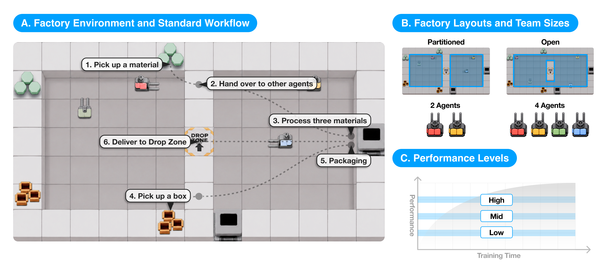
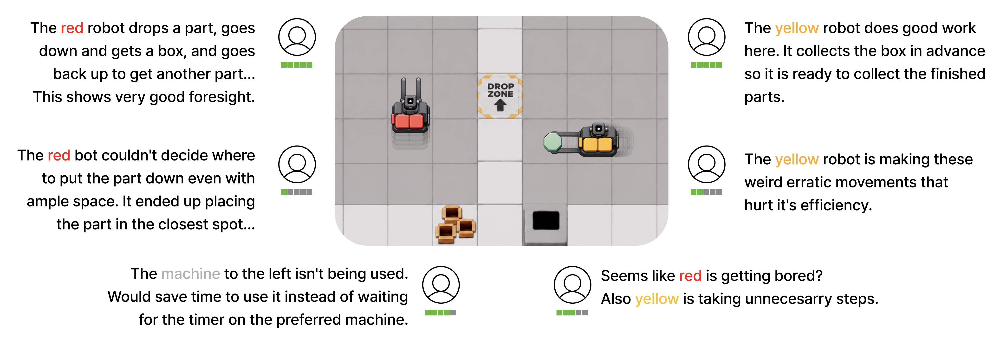

# Multi-Agent Observer Feedback

Agent trajectories and observer responses from a simulated factory collaboration study (108 trajectories; 216 observers).

## Task and feedback

Agents collaborated in a simulated factory. The videos varied by layout, team size, and performance level.

*Factory task and experimental conditions.*

Observers could describe the same behavior in different ways, as the example below illustrates.

*Example of observer feedback on agent behavior.*

## Data

| File | Unit | Count |
| --- | --- | ---: |
| `data/trajectory_manifest.csv` and `data/trajectories/T*.json` | agent trajectory | 108 |
| `data/participants.csv` | observer | 216 |
| `data/episode_ratings.csv` | observer × trajectory rating | 864 |
| `data/feedback.jsonl` | feedback item | 1,746 |
| `data/post_survey.jsonl` | post-study response | 216 |

Join feedback to ratings by `observation_id`, ratings to participants by `participant_id`, and ratings to the trajectory manifest by `trajectory_id`. The [data dictionary](docs/data_dictionary.md) defines each field and survey question; `SHA256SUMS` lists file checksums.

## Access and reuse

Participant identifiers and exact timestamps were removed; written feedback remains verbatim. This release is available for public viewing. No license for reuse, redistribution, or adaptation is granted.
